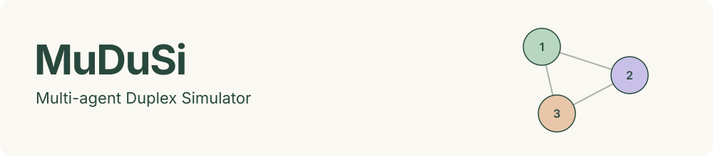

<div align="center">



Full-duplex speech agents, sharing one acoustic world.

[](https://github.com/KyuDan1/MuDuSi/actions/workflows/check.yml)
[](LICENSE)

Test speech agents in a virtual acoustic world before arranging microphones, speakers, and physical devices.

[Project page](https://kyudan1.github.io/MuDuSi/) · [Technical report](https://kyudan1.github.io/MuDuSi/paper/) · [Quick start](#quick-start) · [Simulation modes](#simulation-modes) · [GPU setup](docs/GPU_SERVER.md) · [Contribute](CONTRIBUTING.md)

**24 kHz audio · simultaneous listening and speaking · per-agent microphone recordings**

</div>

Watch the two-friend, clerk/customer, and three-agent conversations on the [project page](https://kyudan1.github.io/MuDuSi/). The examples use actual model-generated speech; captions are offline, word-timed ASR. See [recording provenance and limitations](docs/SHOWCASE.md).

## Why MuDuSi?

Testing conversational speech systems often starts with assembling devices, routing microphones and speakers, arranging a room, and repeatedly recording interactions. MuDuSi replaces that initial acoustic setup with software: connect independent model workers, place their agents in a shared 3D room, and inspect what each agent says and actually hears. No physical microphone or speaker is required for these simulated tests.

This makes early integration, controlled acoustic comparisons, and rollout inspection easier to repeat. It also preserves evidence that a physical demo can be hard to reconstruct: each source waveform, each microphone mixture, the exact model-input blocks, and the corresponding scene and timing. Real-device validation remains a separate step for microphone/speaker response, hardware latency, feedback, echo cancellation, and real-room acoustics.

## Features and current scope

| Capability | Available today | Scope |
|---|---|---|
| **Multi-agent conversations** | Independent input/output streams let agents listen and speak simultaneously; tested two- and three-agent conversations | Three named slots per simulation; native models need separate worker processes/endpoints |
| **Spatial acoustics** | Distance attenuation, sample-level propagation delay, divider occlusion, one wall reflection, and independent microphone noise | Mono audio; no calibrated RIR, HRTF, diffraction, or self-echo |
| **Acoustic scenes and stimuli** | Roundtable, interruption, cocktail, and quiet presets; position/mute/noise/reflection controls; WAV stimulus worker | Noise is Gaussian; a WAV source occupies one agent slot. Preset demo dialogue does not script real-model responses |
| **3D observation and replay** | Speaker/listener activity, per-agent receiver monitoring, TX/RX levels, overlap, timing, buffer counters, and recorded scene playback | One experiment per server; several browsers observe that same experiment |
| **Model integration** | Native PersonaPlex/Moshi bridges, a Raon adapter, and a generic streaming PCM worker protocol | PersonaPlex/Moshi conversations verified; Raon has documented quality/pacing limits; new models need compatible workers |
| **ASR and speaker analysis** | Optional receiver ASR; offline emitted/received-audio transcription; clean source channels retained alongside microphone mixtures | Built-in ASR does not diarize speakers. Diarization models can process saved mixtures externally; speaker-attributed live events need an added observer/schema |
| **RL trajectory inspection** | Aligned input/action/receiver WAVs, frame traces, acoustic rewards, and a trainer-controlled Python environment | Toy on-policy gate training works; full SLM policy training and token-level rollout instrumentation are future integrations |

### Independent experiments in parallel

Run separate server processes on separate ports to compare independent simulations in browser tabs. Each process owns its own scene, clock, and history; opening two tabs on the same port shares one experiment. For example, two CPU demonstrations can run in separate terminals:

```bash
mudusi serve --scenario quiet --port 8765
mudusi serve --scenario cocktail --port 8766
```

For concurrent real-model experiments, allocate separate worker sessions/endpoints, adequate GPU resources, and distinct recording directories. The native reference servers serialize sessions, so reusing one endpoint does not create independent concurrent agents.

The [nine-room matrix runner](docs/MATRIX.md) runs all ordered pairs of Moshi, PersonaPlex, and Raon with 18 independent model processes. Its measured four-GPU configuration synchronizes nine independent acoustic engines with one start barrier. Replay the recordings in a 3×3 dashboard with face-to-face agents, a common clock, captions, and selectable room audio. This bounded inference runner does not implement a vectorized RL training scheduler. The [four-GPU results](docs/MATRIX_RESULTS.md) verify all eighteen agents emitting audio with correct routing and no sustained underruns at 0.25× collection speed (60 audio seconds in about 240 wall seconds), rather than real-time throughput.

### See what an RL policy experienced

A scalar reward cannot show whether an agent answered through noise, spoke over another agent, or received a delayed utterance. MuDuSi links the acoustic observations and emitted actions to the room state and per-frame reward terms. Researchers can inspect the trajectory, listen to an agent's actual input, and compare recorded episodes before choosing or debugging a training objective.

Completed native-model evaluations replay in the 3D viewer. The Python environment exposes observations, rewards, boundary flags, and scene snapshots for custom trainers; recording or displaying a custom trainer's rollouts requires connecting that trainer to the export/viewer path. Neither the viewer nor an acoustic recording supplies the missing SLM token log-probabilities or performs model-weight optimization. See the [two workflows below](#simulation-modes) and the [SLM training interface plan](docs/SLM_TRAINING.md).

## Quick start

Requires Python 3.11+ and Node.js 22+. Model workers use separate environments; Python 3.12 is a suitable starting point for their dependencies.

```bash
git clone https://github.com/KyuDan1/MuDuSi.git MuDuSi
cd MuDuSi
python3 -m venv .venv
source .venv/bin/activate
pip install -e '.[dev]'
npm --prefix web ci
npm --prefix web run build
mudusi serve
```

Open **http://127.0.0.1:8765** and press **Run**. This default mode needs no GPU or model download: it uses synthetic tones and scripted captions to demonstrate the simulator. The videos on the project page use real model workers.

For frontend development, run `npm --prefix web run dev` in a second terminal. The viewer on port 5173 connects to the API on port 8765.

## Simulation modes

| Workflow | Use it for | Entry point | Result |
|---|---|---|---|
| **1. Inference and evaluation** | Let speech models converse; inspect acoustics, responses, overlap, and runtime health | `serve --models …` or `evaluate --models …` | Interactive session or recorded experiment |
| **2. Trajectory collection for RL research** | Preserve acoustic observations/actions/rewards, or integrate a policy with the environment | `evaluate --models …` for real-model recordings; `DuplexArenaEnv` for trainer-controlled steps | Acoustic trajectories; model-side token instrumentation is still needed for SLM RL |

These are two workflows over the same simulator, not two separate CLI flags. The existing full-weight speech models run inference; the included trainable example is a small speak/listen gate policy.

### 1. Run conversations and evaluate inference

Install the streaming bridge in the arena environment:

```bash
pip install -e '.[models]'
```

Follow [GPU setup](docs/GPU_SERVER.md) to install and start the native workers. **PersonaPlex and Moshi must use separate Python environments** because both install a package named `moshi`. Use one native worker process and a distinct endpoint per agent; the verified deployment used one GPU per agent.

Prepare an ignored local configuration from the example. Edit worker URLs and prompts; remove the `custom` entry for a two-model experiment unless its endpoint is running.

```bash
cp configs/workers.example.json configs/local-workers.json
# Edit configs/local-workers.json, then start its workers.

# Interactive simulation: open the viewer and press Run.
mudusi serve --models configs/local-workers.json

# Headless evaluation: records a complete 60-second conversation at wall-clock 1×.
mudusi evaluate --models configs/local-workers.json \
  --scenario quiet --seconds 60 --output runs/conversation

# Optional room controls: add --configuration configs/two-agent-stage.example.json.
# After evaluation completes, replay its audio and 3D state without GPU workers.
mudusi serve --replay runs/conversation --port 18766
```

Open `http://127.0.0.1:18766/` for the engineering view or `http://127.0.0.1:18766/?showcase` for presentation playback. For a remote replay server:

```bash
ssh -N -L 18766:127.0.0.1:18766 YOUR_SSH_LOGIN_ALIAS
```

On the shared B200 cluster, run inference and evaluation together inside a Slurm job, then replay the finished artifacts. The provided cafe configuration launches two PersonaPlex agents:

```bash
export PERSONAPLEX_PYTHON=/path/to/personaplex/environment/bin/python
mkdir -p runs
sbatch --gres=gpu:2 --mem=96G workers/conversation.sbatch \
  --models configs/cafe.example.json \
  --configuration configs/two-agent-stage.example.json \
  --seconds 60 --output runs/cafe
```

The batch launcher starts and stops its workers automatically. For PersonaPlex–Moshi conversations, also set `MOSHI_PYTHON`; see [two/three-agent configurations and video export](docs/SHOWCASE.md). For a controlled opening utterance, [use the WAV stimulus worker](docs/GPU_SERVER.md#4-connect-and-open-the-arena). A WAV source is a stimulus, not another model.

### 2. Collect trajectories for RL research

A real-model evaluation already records an **acoustic trajectory**. Use a new output directory for each episode:

```bash
mudusi evaluate --models configs/local-workers.json \
  --configuration configs/two-agent-stage.example.json \
  --seed 42 --seconds 60 --output runs/trajectories/episode-0001
```

| Artifact | Contents |
|---|---|
| `trace.jsonl` | One snapshot per 80 ms tick: geometry, activity, model-generated text, acoustic reward terms, and worker/timing diagnostics |
| `<agent>-emitted.wav` | Agent emission at the simulator boundary: the acoustic action |
| `<agent>-received.wav` | Spatially mixed audio at that agent's microphone |
| `<agent>-input.wav` | PCM block supplied to its adapter: clipped previous-tick receiver audio; initially silence |
| `summary.json` | Completion status, duration, timing, final state, and input alignment |

WAVs use 24 kHz mono PCM16. A tick spans 1,920 samples, so tick indices align the audio files with the trace. Live inference is wall-clock paced and is not bitwise reproducible from the acoustic seed alone. Preserve model revisions, sampling settings, prompts, and runtime versions with each experiment; the conversation batch launcher adds a manifest.

For trainer-controlled rollouts, use the Python environment. All agents act simultaneously; each observation contains its own mixed microphone audio, position, and simulation time:

```python
import numpy as np
from duplex_arena.env import DuplexArenaEnv

env = DuplexArenaEnv(seed=42, horizon=750)
observations, infos = env.reset()
while env.agents:
    # Replace silence with each policy's next 1,920-sample float32 PCM emission.
    actions = {
        agent: np.zeros(env.frame_size, dtype=np.float32)
        for agent in env.agents
    }
    next_observations, rewards, terminated, truncated, infos = env.step(actions)
    # Store observations, actions, rewards, next_observations and boundary flags here.
    observations = next_observations
env.close()
```

This PettingZoo-style dictionary interface is not a registered PettingZoo environment and does not automatically attach the native model servers. A working CPU REINFORCE example supplies its own tiny stochastic gate policies, logs behavior log-probabilities and policy versions, and updates them after each frozen-policy rollout:

```bash
python examples/on_policy.py --episodes 12 --output runs/gates
```

**Full-weight SLM RL is not implemented.** Native audio/text WebSockets do not expose sampled token actions, behavior log-probabilities, value estimates, token-to-audio alignment, or learner/actor policy-version barriers. Acoustic recordings alone are insufficient to claim an on-policy SLM update. The required interfaces and staged training plan are in [SLM training](docs/SLM_TRAINING.md).

## Validation and interpretation

The [B200 verification record](docs/B200_VERIFICATION.md) and [showcase report](docs/SHOWCASE.md) document real PersonaPlex/Moshi runs, receiver-to-input checks, memory use, pacing, and buffer counters. The showcased two/three-agent runs had no dropped output, input overflow, or clipping, with small startup underruns recorded explicitly. They demonstrate the interaction path; selected short clips do not establish reliable long-form dialogue or role adherence.

- Levels are **dBFS**, not calibrated sound pressure. Listener activity detects audio energy, not comprehension.
- Acoustic propagation uses 343 m/s; visual wave rings are deliberately slowed. Reflection is a single wall image source, without HRTF, diffraction, or a calibrated room impulse response.
- Rewards combine audibility, overlap, and energy. They are acoustic heuristics, not semantic conversation scores; useful backchannels may receive overlap penalties.
- Model-generated text, emitted-audio captions, and [receiver ASR](docs/ASR.md) have distinct provenance. The presentation's word-timed captions are offline ASR, not a streaming ASR latency measurement.
- The current engine has three named agent slots and excludes self-sidetone/self-echo. Live UI history is bounded; use headless evaluation to retain complete recordings.

Check the CPU engine and worker transport without model weights:

```bash
# Synthetic evaluation and tests.
mudusi evaluate --scenario cocktail --seed 42 --seconds 18 --output runs/demo
pytest -q

# In separate terminals: an echo protocol probe, then its viewer (not a language model).
python -m workers.echo_worker --port 9001
mudusi serve --models configs/echo.example.json
```

## Citation

If you use MuDuSi in your research, please cite the [technical report](https://kyudan1.github.io/MuDuSi/paper/):

> Kyudan Jung and Jaegul Choo. **MuDuSi: A Multi-Agent Acoustic Simulator for Full-Duplex Speech Language Models.** MuDuSi Project, Technical Report MUDUSI-TR-2026-01, version 1.1, October 13, 2026. Both authors: KAIST AI.

```bibtex
@techreport{jung2026mudusi,
  author      = {Jung, Kyudan and Choo, Jaegul},
  title       = {{MuDuSi}: A Multi-Agent Acoustic Simulator for Full-Duplex Speech Language Models},
  institution = {MuDuSi Project},
  type        = {Technical Report},
  number      = {MUDUSI-TR-2026-01},
  year        = {2026},
  month       = oct,
  note        = {Version 1.1, October 13, 2026},
  url         = {https://kyudan1.github.io/MuDuSi/paper/}
}
```

[Download BibTeX](CITATION.bib) · [Citation metadata](CITATION.cff) · [Publication and Scholar indexing notes](doc/SCHOLAR.md)

The report is self-published; its NeurIPS-style layout does not imply conference acceptance. Citation metadata makes the work citable and does not establish Google Scholar indexing.

## Contributing

Contributions to model workers, acoustic validation, speech analysis, evaluation tasks, and rollout/trainer interfaces are welcome. The [contribution guide](CONTRIBUTING.md) covers local setup, focused checks, adapter requirements, reproducible evidence, and recording privacy. Please distinguish implemented behavior from proposed integrations in code, examples, and claims.

## Documentation

[Technical report (PDF)](https://kyudan1.github.io/MuDuSi/paper/mudusi-technical-report.pdf) · [LaTeX source](doc/mudusi-technical-report.tex) · [Architecture](docs/ARCHITECTURE.md) · [GPU setup](docs/GPU_SERVER.md) · [Model protocols](docs/MODELS.md) · [ASR](docs/ASR.md) · [Showcase recording](docs/SHOWCASE.md) · [SLM training plan](docs/SLM_TRAINING.md)

Simulator code is available under the [MIT license](LICENSE). Model weights and bundled font assets retain their own licenses.

Built around [NVIDIA PersonaPlex](https://github.com/NVIDIA/personaplex) and [Kyutai Moshi](https://github.com/kyutai-labs/moshi). Model names identify supported integrations; they do not imply affiliation with their providers.
