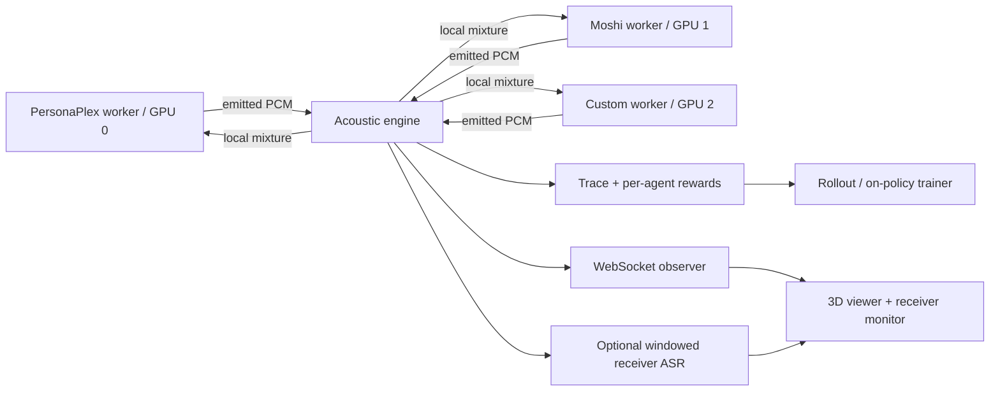

# Architecture and research plan

## Virtual testbed and independent sessions

MuDuSi lets independent model sessions interact in a virtual acoustic room before
assembling a physical microphone/loudspeaker setup for each agent. This supports
software experiments with multiple speakers, noise, positions, and occlusion;
it does not replace real-device or room validation. Each agent keeps its own
model state and receives its own microphone mixture. The 3D view visualizes these
sessions together in one scene.

Independent experiments can use separate evaluator processes, ports, and output
directories. The current UI does not orchestrate or display multiple concurrent
scenes in one dashboard. It implements three named agent slots, not arbitrary
agent counts.

A model capable of speaker diarization can in principle consume a multi-speaker
receiver mixture through a compatible worker. Diarization-specific outputs,
identity tracking, and scoring are not implemented or verified. Simulator source
IDs and per-source ASR labels are known provenance, not inferred diarization.
Adding that evaluation requires timestamped predicted labels, receiver-aligned
reference activity, and overlap-aware metrics; multichannel inputs would need a
new adapter contract beyond the current mono PCM stream.

## One simulation, two execution modes

The engine accepts simultaneous `float32[1920]` emissions at 24,000 Hz. A receiver
gets only other sources with independent noise. At action boundary t, policies
consume the observation from the previous completed frame. All current actions
are then propagated together into the next observation. Frame decision latency
(80 ms) is distinct from sample-level acoustic latency (typically 1–40 ms here).

Headless mode advances simulation time deterministically, as fast as the CPU
permits. Live mode has independent async worker send/receive loops and a paced
80 ms simulator. No browser request drives the clock. Slow observers have bounded
queues; stale visual frames are dropped, never backpressuring physical time.
Workers have bounded queues and expose underruns/overflows. Hardware/model timing
means live episodes are not bitwise reproducible from the seed alone.

## Signal model

For source i and receiver j, distance d is Euclidean in meters. Direct pressure
gain is `1/max(1,d)`, multiplied by `10^(-loss_db/20)` for each intersecting divider.
Delay is `ceil(d/343*sample_rate)` samples: never earlier than physical arrival.
Queued samples survive frame boundaries. Geometry is evaluated at emission time.
Moving a character changes newly emitted sound and does not rewrite prior sound.

The optional reflection uses one right-wall image source. Its pressure gain is
`reverb * 0.45 / max(1, reflected_distance)`. This control is a reflection amount,
not a calibrated RT60. Gaussian mic noise has RMS `10^(noise_db/20)`. Raw simulation
retains unclipped superposition. WAV encoding and live worker ADC inputs clamp
to [-1,1]; clipping counts are observable. There is no own-source path.

## Truth in visualization

The only authority is the engine snapshot. Characters show transmitted and
received RMS independently, including simultaneous activity. Wave rings slow
down propagation intentionally so it can be seen. dBFS is not dB SPL. The
listener activity threshold is an energy detector, not understanding or ASR.
Scripted captions, model-generated text and external receiver ASR have separate
provenance. Monitor audio is a receiver's actual mixed PCM stream.

## Reward and credit

Rewards decompose into source audibility, an overlap cost, and emission energy.
They are acoustic development proxies. No semantic judge is implied. The core
provides one reward per agent per frame; downstream code can replace the reward
function with task success, interruption recovery, latency, intelligibility,
or human preference objectives. Critic-only global state must not be leaked to
actor observations when using centralized training and decentralized execution.

The working REINFORCE example logs behavior probabilities and policy version,
freezes policies for one rollout, computes discounted per-agent returns, and
then updates all policies. It optimizes a tiny gate, not SLM weights. SLM RL will
need token-to-audio timing alignment and model-side action log-probabilities.
Do not relabel real-time black-box inference traces as on-policy training data
when token probabilities or matching behavior policy versions are unavailable.

## Reproducibility

`seed`, scenario, sample rate, tick index, geometry, noise, reward terms and
source/receiver levels are logged. Headless exports stream all frames to JSONL
and each receiver WAV. The observer server caps its in-memory history. Model
revision, sampling parameters, GPU runtime and policy version must be added to
real experimental manifests; the config itself is deliberately not exported
because it can contain private worker addresses and prompts.

## Delivery stages

| Stage | Current state | Acceptance condition |
| --- | --- | --- |
| CPU acoustic core | Implemented | Impulse delay, superposition, loss, echo and seed tests |
| 3D observation | Implemented | Live telemetry, controls, receiver playback and exports |
| Worker transports | Implemented | Echo loop and Opus protocol/codec checks |
| Real GPU model exercise | B200 PersonaPlex/Moshi verified | Two paced conversations, source/receiver/input WAVs, buffer diagnostics and 3D replay |
| Receiver ASR | Offline Whisper verified on B200 run artifacts | Separate generated text from noisy receiver recognition |
| On-policy environment integration | Implemented toy gate | Current-policy rollouts and per-agent temporal credit |
| SLM token-policy trainer | Planned | Model-side token log-probs, aligned reward/value streams, policy barriers |
| High fidelity acoustics | Planned | Measured or image-source RIR, HRTF, directional microphones, RT60 validation |
| Research benchmark suite | Planned | Labeled tasks, semantic metrics, multilingual and adversarial overlaps |

## Scale and boundaries

This first implementation has three named agent slots and O(N²) acoustic paths.
GPU allocation belongs to worker launch configuration. The viewer never loads
weights. The built viewer and API run as one local process; no cloud account is
required. The service has no multi-user authentication and defaults to loopback.
Use an SSH tunnel or a trusted authenticated reverse proxy on a GPU server.

Future work should separate experiment orchestration from real-time interaction,
add vectorized headless environments and policy barriers, and reserve GPU memory
separately for inference, training, ASR and reward models.

`evaluation.evaluate_live` now reuses the viewer Session for bounded batch
experiments. `ReplaySession` serves completed trace/WAV artifacts without any
connection back to a batch worker; it rejects acoustic edits and labels playback
as recorded. Model launchers and the evaluator are co-located within a Slurm pod.
See [measured server results](B200_VERIFICATION.md) and the
[SLM learner contract](SLM_TRAINING.md).
